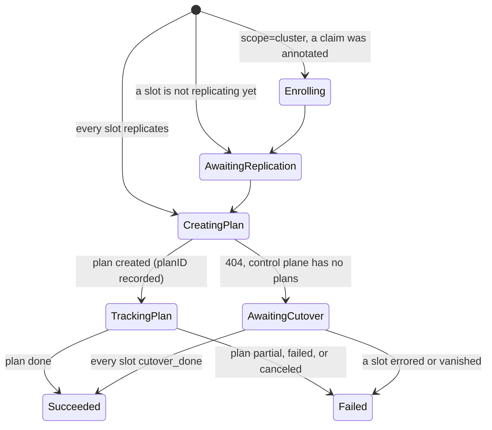

# Design Document: Online Cross-Cluster Migration Through Migration Plans

**Status:** Implemented  
**Author:** Michael Schmidt  
**Date:** 2026-10-22  
**Test Plan:** [`tests/test-plan-replication-migration-plans.md`](../tests/test-plan-replication-migration-plans.md)

---

## Table of Contents

1. [Background](#1-background)
2. [Goals and Non-Goals](#2-goals-and-non-goals)
3. [API Changes](#3-api-changes)
4. [Reconciler Flow](#4-reconciler-flow)
5. [Control-Plane Contract](#5-control-plane-contract)
6. [Admission](#6-admission)
7. [Observability](#7-observability)
8. [Testing Strategy](#8-testing-strategy)
9. [Open Questions](#9-open-questions)

---

## 1. Background

`ReplicationOps` with `action: migration` moves volumes to the target cluster of
a `ReplicationPair` online. It is the last step of snapshot replication in
`migration` mode: a short I/O freeze copies the final delta, and the NVMe-oF
paths switch to the target cluster.
[`design-snapshot-replication-policy.md`](design-snapshot-replication-policy.md)
§9 introduced the action.

The action did three things that this design changes.

| Behavior                                                                                                                         | Consequence                                                                                                |
|----------------------------------------------------------------------------------------------------------------------------------|------------------------------------------------------------------------------------------------------------|
| It called `POST .../replication/commit` once per slot and set the operation to `Succeeded` as soon as every commit was accepted. | A `Succeeded` migration said nothing about whether any volume had moved. Waiting meant watching each slot. |
| It covered only volumes that already had a `ReplicationSlot`.                                                                    | Moving every volume of a cluster meant annotating every claim by hand first.                               |
| It had no notion of progress or duration.                                                                                        | Nothing could say how much data was left or when the migration would finish.                               |

The storage control plane now has **migration plans** (sbcli
`docs/online-migration.md`). A plan:

- holds a set of volumes;
- starts replication for each volume that has none;
- queues every cutover at once, so the cutovers run one at a time per source
  lvstore;
- places the volumes evenly on target nodes;
- forecasts bytes remaining and time to completion, per volume and for the whole
  plan.

## 2. Goals and Non-Goals

**Goals**

- One `ReplicationOps` migrates a whole storage cluster's claims, in every
  namespace, enrolling the ones that are not replicated yet.
- The operation stays `Running` until every volume has cut over, and ends
  `Failed`, with per-volume results, when any volume did not.
- Status carries per-volume progress and a migration-wide forecast.
- A dry run publishes the plan and forecast with no side effects.
- The per-volume cutover (preconnect Job, cutover-proceed) is unchanged and
  stays with the `ReplicationSlot` reconciler.

**Non-Goals**

- A new CRD. Migration is an action on an existing `Ops` kind (see
  `design-crd-model.md` §3).
- Canceling a running plan from Kubernetes. Deleting the `ReplicationOps`
  releases its lock; the plan continues in the control plane.

## 3. API Changes

All additions are optional fields, plus new enum values. Every existing object
stays valid.

**`ReplicationOpsSpec`**

| Field             | Change                                                                                                                                                        |
|-------------------|---------------------------------------------------------------------------------------------------------------------------------------------------------------|
| `scope`           | New value `cluster`. `ref` then names the source `StorageCluster`, or carries its UUID.                                                                       |
| `policyRef` (new) | Required for `scope: cluster`, and refused otherwise. Names the `ReplicationPolicy`, in `mode: migration`, that not-yet-replicated claims are enrolled under. |
| `dryRun` (new)    | Migration only. Publishes the plan and forecast, and changes nothing.                                                                                         |

Both new fields carry `+k8s:immutable`.

**`ReplicationOpsStatus`**

| Field            | Meaning                                                                                                                                                                           |
|------------------|-----------------------------------------------------------------------------------------------------------------------------------------------------------------------------------|
| `planID` (new)   | The control-plane plan this operation drives. Set once, never replaced.                                                                                                           |
| `forecast` (new) | `bytesRemaining`, `etaSeconds`, `completesAt`, `throughputBytesPerSec`, and `throughputMeasured` (false while a default rate is assumed).                                         |
| `results[]`      | New fields `pvcRef`, `state` (the plan's per-volume state), `targetNodeID`, `bytesRemaining`, and `etaSeconds`. `status` gains `pending`, which only a running migration reports. |

A `printcolumn` named `ETA` at `priority=1` shows `forecast.etaSeconds` in
`kubectl get -o wide`.

The scope and action values stay lowercase. The kind already uses lowercase for
both, and stored objects carry the existing values.

## 4. Reconciler Flow

The lock is the one the kind already uses: the pair for `scope: target`, and a
policy for every other scope, which is `spec.policyRef` for `scope: cluster`.
Each pass decides what to do from `status.planID` and `status.subphase`:

1. **Scope.**
   - `scope: policy`, `volume`, and `target` use the slots they always did.
   - `scope: cluster` lists the bound claims of **every namespace**. A claim
     counts when its persistent volume's CSI handle names the source cluster.
     Workloads keep their claims in their own namespaces, while the
     StorageCluster and the replication objects live in the storage namespace,
     so a scope limited to the operation's namespace would miss them.
     - A claim with a slot under `policyRef` is included.
     - A claim with a slot under another policy is skipped.
     - A claim with no slot is enrolled by setting the
       `storage.simplyblock.io/replication-policy` annotation. The PVC
       annotation watcher then creates the slot as for any annotated claim.
       A claim outside the policy's namespace is annotated with
       `<namespace>/<name>`; see §4.1.
     - A claim that the annotation, or its StorageClass, already assigns to
       another policy is skipped. It is never overwritten.
2. **Wait.** The plan is created only once every included slot is
   `replicating`:
   - an `error` slot becomes a `failed` result;
   - `cutover_done` and `failed_over` slots are skipped;
   - the operation requeues every 15 s meanwhile.
3. **Create.** Before the POST the operation writes `subphase: CreatingPlan`.
   The plan carries a name, `replicationops/<namespace>/<name>/<uid>`. A pass
   that finds `CreatingPlan` without a `planID` first lists the plans and adopts
   the one with its name, so a pass that died after the POST never creates a
   second plan.
4. **Track.** `GET` the plan every 30 s, and mirror its volumes into `results`
   and its forecast into `forecast`.
   - A read error requeues and is not a failure, because the plan keeps running
     in the control plane.
   - A plan that is `done` ends the operation `Succeeded`.
   - A plan that is `partial`, `failed`, or `canceled` ends it `Failed`, with
     the results kept.
   - The skips from enrollment stay next to the plan's volumes.
5. **No plans in the control plane.** A `404` on the POST means the control
   plane predates migration plans. The operation falls back to one commit per
   slot and sets each slot to `cutover_pending`, as the commit path always did.
   It then follows the slots to `cutover_done` (`subphase: AwaitingCutover`)
   instead of succeeding at once. A dry run against such a control plane fails,
   because nothing can forecast.

**The slots on the plan path are not touched.** The backend's
`cutover_pending` is what the slot reconciler's `reconcileReplicating` watches.
It polls every 15 s, which is inside the backend's cutover-proceed timeout, and
jumps straight into `reconcileCutoverPending`, so the preconnect Job and
cutover-proceed run as before. The commit path set slots to `cutover_pending`
early so they polled at the 5 s cutover interval. A plan can spend hours on the
initial copy, so setting slots early there would poll every volume at 5 s for
the whole copy.

### 4.1 Cross-namespace references

A slot is owned by its claim, and an owner reference cannot cross namespaces,
so the slot always lives beside the claim. The policy it follows can live
elsewhere, so a policy reference is written either way:

| Written as        | Means                                                               |
|-------------------|---------------------------------------------------------------------|
| `pol`             | the policy `pol` in the referring object's own namespace, as before |
| `simplyblock/pol` | the policy `pol` in namespace `simplyblock`                         |

- **Where it applies:** the PVC (or StorageClass) annotation and
  `ReplicationSlot.spec.policyRef`. The PVC watcher, the slot reconciler, and
  the policy reconciler resolve both forms (`utils.SplitRef`).
- **Slot names:** a slot is still named `<policy name>-<claim>`. The namespace
  part of a reference never reaches an object name.
- **Index:** the `spec.policyRef` slot index holds the canonical
  `<namespace>/<name>` form, so a policy's `slotCount` and its deletion guard
  count the slots of every namespace. Otherwise, a policy could be deleted while
  a claim elsewhere still follows it.
- **Results:** `pvcRef` and `slotRef` stay bare names in the operation's
  namespace, and are written `<namespace>/<name>` for objects elsewhere.
- **RBAC:** unchanged. The operator's ClusterRole already lists and patches
  claims cluster-wide.

## 5. Control-Plane Contract

The REST API is under `/api/v2/clusters/{source_cluster_id}/migration-plans`,
specified in sbcli `docs/online-migration.md`.

| Call        | Body or result                                                                                                                                                                                                  |
|-------------|-----------------------------------------------------------------------------------------------------------------------------------------------------------------------------------------------------------------|
| `POST /`    | Body: `{target_cluster_id?, lvol_ids, delete_source, dry_run?, name}`. Returns `201` with the `MigrationPlanDTO`. A dry run returns `200` with `id: null`.                                                      |
| `GET /`     | A list of `MigrationPlanDTO`. Used only to adopt a plan by `name`.                                                                                                                                              |
| `GET /{id}` | `MigrationPlanDTO`: `status` (`running`, `done`, `partial`, `failed`, or `canceled`), `volumes[]` (`lvol_id`, `state`, `target_node_id`, `error`, `bytes_total`, `bytes_remaining`, `eta_seconds`), `forecast`. |

- `target_cluster_id` is the pair's target cluster when it resolves locally. It
  is omitted otherwise, and the plan uses the volumes' own replication target.
- `completes_at` is read as either RFC 3339 text or epoch seconds.

## 6. Admission

`ReplicationOpsValidator` adds these rules on create:

- `scope: cluster` is allowed only with `action: migration` and a `policyRef`.
- `policyRef` is allowed only with `scope: cluster`. It must name a
  `ReplicationPolicy` in `mode: migration`.
- `ref` must resolve to a `StorageCluster`, or be a UUID.
- `dryRun` is allowed only with `action: migration`.

## 7. Observability

| Signal                             | Where                                                                       |
|------------------------------------|-----------------------------------------------------------------------------|
| Per-volume progress                | `status.results[]`: `state`, `bytesRemaining`, and `etaSeconds`             |
| Forecast                           | `status.forecast`, `kubectl get replops -o wide` (`ETA`)                    |
| Plan created, forecast, completion | Events `MigrationPlanCreated`, `MigrationForecast`, and `MigrationComplete` |
| Failure                            | Event `Failed`, `status.message` with the count of volumes left behind      |

## 8. Testing Strategy

Unit tests use the fake client and a fake control plane:

- `replicationops_migration_test.go`;
- `replicationops_validator_test.go`.

The scenarios are listed in
[`test-plan-replication-migration-plans.md`](../tests/test-plan-replication-migration-plans.md).
The cutover itself is covered by the slot reconciler's existing tests and is
not retested here.

## 9. Open Questions

- **Cancellation.** The control plane can cancel a plan
  (`DELETE /migration-plans/{id}`). A `spec.abort` on the operation could map to
  it. That waits for a user who needs it.
- **Scopes other than `cluster`.** `policy` and `target` still collect the
  slots of the operation's namespace only. Widening them changes what an
  existing operation touches, so it waits for a request.
